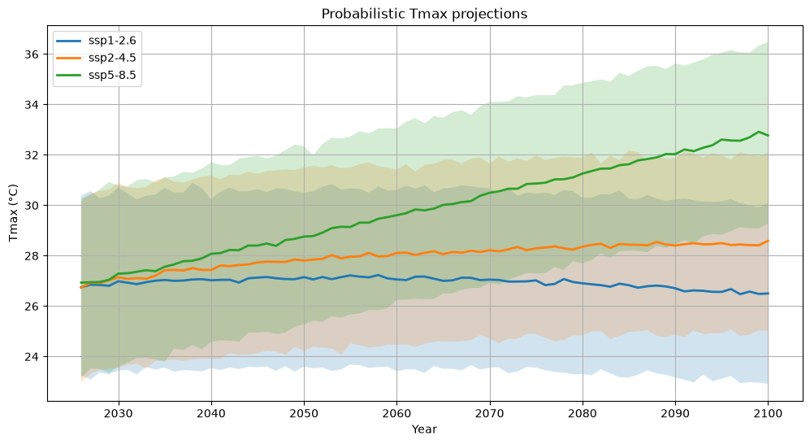
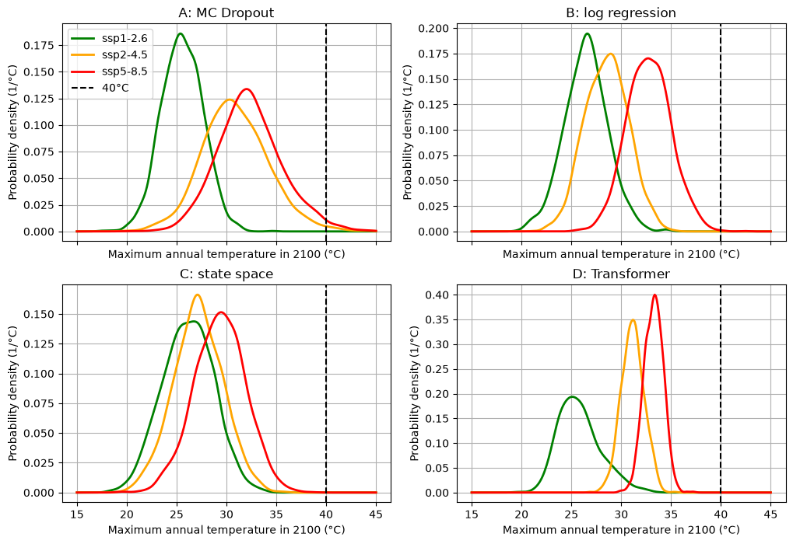

# heatwave-forecasting-ssp

### How hot can Brest get by 2100? Probabilistic forecasts of heat waves and extreme temperatures under three emission scenarios.



*Median and 5–95% envelope of the annual maximum temperature in Brest until 2100 (example with method A, MC Dropout).*

A statistical and machine-learning study of atmospheric heat waves in Brest (Brittany, France), based on ERA5 reanalysis data and CO₂ emission scenarios (SSP).

The full analysis is in [`brest_heatwaves_climate_analysis.ipynb`](brest_heatwaves_climate_analysis.ipynb).

## Overview

**Part 1 – Statistical analysis (1940–2025)**
- Seasonal cycle of the daily mean temperature (10%, 50%, 90% quantiles, 30-day rolling mean)
- Heat-wave detection (consecutive days above the daily 90% quantile), duration and intensity
- Duration–intensity diagram, comparison of a recent year (2025) with 1940

**Part 2 – Machine learning (projections until 2100)**
- Annual maximum temperature and its link with global CO₂ (correlations, transformations, polynomial and neural-network regression)
- Probabilistic projections under SSP1-2.6, SSP2-4.5 and SSP5-8.5 with four methods, all based on Monte Carlo sampling (2000 trajectories):
  - A: neural network + MC Dropout
  - B: logarithmic regression
  - C: state space model (Kalman filter)
  - D: Transformer
- Distribution of the annual maximum in 2100 and probability of exceeding 40 °C
- Same study for the annual minimum, with a bootstrap Monte Carlo approach

## Illustration



*Distribution of the annual maximum temperature in Brest in 2100 for each method (A–D) and each scenario; the dashed line is the 40 °C threshold.*

## Repository structure

```
.
├── brest_heatwaves_climate_analysis.ipynb   # main notebook
├── daily_temp_brest.csv                     # daily mean temperature (°C), 1940-2025
├── yearly_temp_brest.csv                    # annual max/min temperature (°C) and global CO2 (ppm)
├── yearly_future_co2.csv                    # CO2 (ppm) per SSP scenario, 2026-2100
├── images/                                  # figures used in this README
├── requirements.txt
└── README.md
```

## Data

| File | Content |
|---|---|
| `daily_temp_brest.csv` | Daily mean 2 m air temperature in Brest (ERA5), columns `valid_time`, `mean` |
| `yearly_temp_brest.csv` | Annual maximum and minimum temperature (°C) and global annual CO₂ (ppm) |
| `yearly_future_co2.csv` | Future CO₂ concentration (ppm) for `ssp1-2.6`, `ssp2-4.5`, `ssp5-8.5` |

Temperature data come from the ECMWF ERA5 reanalysis (Hersbach et al., 2020, *Q. J. R. Meteorol. Soc.*, 146, 1999–2049).

## Installation and usage

Python 3.10 or later is recommended.

```bash
git clone https://github.com/<your-username>/heatwave-forecasting-ssp.git
cd heatwave-forecasting-ssp

python -m venv .venv
source .venv/bin/activate        # Windows: .venv\Scripts\activate
pip install -r requirements.txt

jupyter notebook brest_heatwaves_climate_analysis.ipynb
```

Training of the neural networks is light and runs on CPU (a GPU is used automatically if available). Random seeds are fixed in the code, but small differences are possible between PyTorch versions and hardware.

## Main results

- Seasonal cycle with a small amplitude (about 9 °C), typical of a temperate oceanic climate.
- Most heat waves are short (3–4 days); the warming signal is visible in their frequency (80 days above the 90% threshold in 2025 against 33 in 1940).
- The annual maximum shows a warming trend of about +0.3 °C per decade, but CO₂ alone explains only a small part of its variability.
- Projections for 2100 depend strongly on the method, because CO₂ goes far outside the historical range; exceeding 40 °C stays a rare event in all models.

See the comments in the notebook for the detailed discussion and the limitations of each method.

## Author

<Your name> – <your email or GitHub profile>
